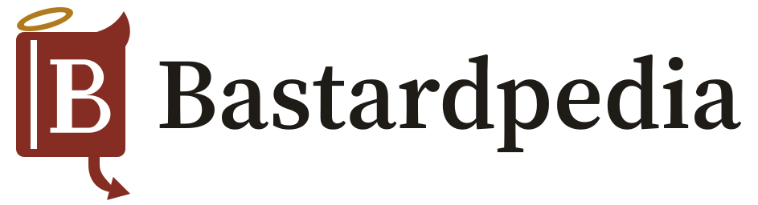

# Bastardpedia logo guidelines

## 1. The logo

**Volume B:** an encyclopedia volume with a serif B on its cover. It has grown
a horn on one corner, wears a slipped halo on the other, and keeps a devil's
tail as its bookmark. It is a reference work that is in on the joke: saint and
sinner on one cover, like the show's bastards and its heroes.



| Version                | Use                                   | Files (`masters/`)                           |
| ---------------------- | ------------------------------------- | -------------------------------------------- |
| Horizontal lockup      | Site header, documents, social banner | `lockup-horizontal.svg`, `-dark`, `-on-mark` |
| Stacked lockup         | Square spaces, splash, about page     | `lockup-stacked.svg`, `-dark`, `-on-mark`    |
| Symbol                 | 32 px and up: app icon, avatar        | `symbol.svg`, `-dark`, `-on-mark`            |
| Symbol, small-size cut | 16 to 24 px: favicon                  | `symbol-small.svg`, `-dark`, `-on-mark`      |
| Wordmark               | Where the symbol already appears      | `wordmark.svg`, `-dark`, `-on-mark`          |

The three colourways of each version are:

- **Plain name (light):** on paper.
- **`-dark`:** on the dark page.
- **`-on-mark`:** on an oxblood tile.

**One-colour versions** (black, white, oxblood) are in `exports/svg/`. The web
and app icon set is in `exports/web/`, and a copy of it ships in `public/`.

**The small-size cut** drops the halo, the tail and the spine groove, and scales
the book up. All three disappear below 32 px, so dropping them keeps the B legible.

## 2. Clear space

Keep clear space on every side equal to the halo's height, about 9% of the
symbol's height. No text, edge or other graphic enters that space. Each master's
viewBox already includes a small margin; the clear space is measured from the
artwork, not from the file edge.

## 3. Minimum size

| Version           | Smallest                                    |
| ----------------- | ------------------------------------------- |
| Symbol            | 32 px tall (below that, the small-size cut) |
| Small-size cut    | 16 px                                       |
| Horizontal lockup | 140 px wide                                 |
| Stacked lockup    | 96 px wide                                  |
| Wordmark          | 100 px wide                                 |

## 4. Colour

Palette **O2**: site oxblood and warm gilt. The tokens are the source of truth
(`design-tokens.json`); the hex values below mirror them.

| Role                | Token               | HEX       | RGB         | CMYK (approx.) |
| ------------------- | ------------------- | --------- | ----------- | -------------- |
| Mark: book and tail | `brand.mark`        | `#852D23` | 133 45 35   | 0 66 74 48     |
| Halo                | `brand.halo`        | `#B07A1E` | 176 122 30  | 0 31 83 31     |
| Wordmark (ink)      | `text.primary`      | `#1F1C18` | 31 28 24    | 0 10 23 88     |
| Paper               | `surface.page`      | `#F7F3EC` | 247 243 236 | 0 2 4 3        |
| Mark, dark mode     | `brand.mark` (dark) | `#D3877A` | 211 135 122 | 0 36 42 17     |
| Halo, dark mode     | `brand.halo` (dark) | `#D9AE52` | 217 174 82  | 0 20 62 15     |

The CMYK values are simple conversions, not press-matched. For print, ask the
printer for the nearest Pantone match. PMS 7623 C and PMS 1255 C are likely
candidates, but check them against a swatch book.

Measured contrast on the site's pages:

| Pair         | Light page | Dark page |
| ------------ | ---------- | --------- |
| Mark on page | 7.92:1     | 6.64:1    |
| Halo on page | 3.36:1     | 8.94:1    |

Both pass the 3:1 minimum for graphics. The halo colour is for the mark only,
never for text.

**Approved backgrounds:**

- paper and light surfaces, with the light version;
- the dark page, with `-dark`;
- solid oxblood, with `-on-mark`;
- calm photos only if contrast stays above 3:1 (otherwise use a tile).

**Alternative palette:** A4, episcopal violet and brass, is kept as a ready
proposal in `proposals/a4-aubergine/`, along with the steps to adopt it.

## 5. Typography

- **Wordmark:** Source Serif 4 Semibold (weight 600, optical size 32), drawn as
  outlines with the font's own kerning (`tools/wordmark.py`). In the site header
  the name is live text in the same face and weight, so it stays accessible and
  follows the theme.
- **Interface:** Source Serif 4 for headings, Inter for the interface.
- **Licence:** both are under the SIL Open Font License, which permits logo use.

## 6. Don'ts

- **The drawing:**
  - Don't redraw, stretch, rotate or outline the mark.
  - Don't separate the halo from the book or move it.
  - Don't recolour the halo in the book colour in the two-colour version.
  - Don't add shadows, gradients, glows or textures.
- **Size and background:**
  - Don't use the full symbol below 32 px; use the small-size cut.
  - Don't place the light version on dark or busy backgrounds; use `-dark`
    or `-on-mark`.
- **The name and the show:**
  - Don't set the name in another typeface next to the symbol.
  - Don't combine the mark with the show's artwork, colours or name in a way
    that suggests the site is official.

## 7. Rebuilding the kit

Everything is generated from `tools/geometry.py` (the symbol) and Source Serif 4
(the wordmark). The tools need Python 3 with `fonttools` and `brotli`; the
logo-design skill's scripts handle the exports.

```sh
python3 brand/tools/build_masters.py                 # brand/masters + src/ui/logo-paths.ts
python3 brand/tools/build_masters.py --palette a4 --out brand/proposals/a4-aubergine/masters
# exports (logo-design skill scripts):
export_variants.py brand/masters/symbol.svg --name symbol --icon-bg "#852D23" --icon-fg "#F7F3EC" --mono "#852D23" --web-icons --out-dir <tmp>
export_variants.py brand/masters/symbol-small.svg --name small --icon-bg "#852D23" --icon-fg "#F7F3EC" --icon-scale 0.86 --only app-icon --out-dir <tmp>
```

These commands produce the following:

- **Favicon:** `exports/web/favicon.svg` is the small cut on the oxblood tile,
  with the mark at 86% scale. The `favicon.ico` file (16, 32 and 48 px) and the
  favicon PNGs are rendered from it.
- **Large icons:** the app icons (180, 192 and 512 px, plus the maskable icon)
  come from the full symbol.
- **App code:** after rebuilding, copy `exports/web/*` to `public/`. The
  `src/ui/logo-paths.test.ts` test fails if the app's logo drifts from
  `masters/symbol.svg`.

## 8. Decisions and open items

- **Concept:** chosen from five rounds of concepts (letter B, reference-work
  signs, citation brackets, books). The presentation is in
  `board/board.html`, and its slides are in `board/slides/`.
- **Palette:** O2 rather than A4. In oxblood the book reads as the devil and the
  gold halo as the contradiction, which is the joke. O2 is also the oxblood the
  interface already used. A4 is more distinctive in the media category and is
  kept as a proposal.
- **Tests run:**
  - the SVG audit, which scores 100/100 for the symbol and the small cut;
  - pixel tests at 16 and 32 px;
  - light, dark and on-tile renders;
  - a contrast measurement of every colour pair.
- **Legal (a desk check, not legal advice):**
  - **Name:** no existing "Bastardpedia" was found, and no registration of
    "Behind the Bastards" turned up (that search is not conclusive).
  - **Logo:** the closest mark found is a pending US application, HORNSBY &
    HALO (comic books, horns, halo and tail on letters). Our mark is different:
    a book, a different overall impression and different goods.
  - **Before the public launch:**
    - run a USPTO search (and an EUIPO TMview search if relevant);
    - run a reverse image search on the mark;
    - keep the "unofficial, not affiliated" note on the site;
    - have a trademark lawyer review the mark if you plan to register it.
